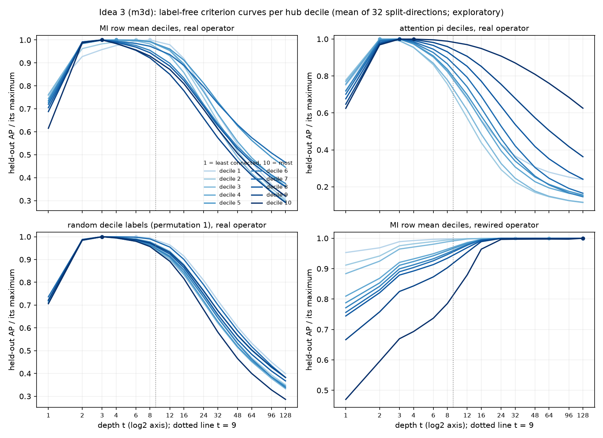

# Exploratory: adaptive depth by hub decile on a log grid (ideation memo idea 3): results

**Status.** EXPLORATORY. M3D is the tuning set and K562 is spent (CORUM and DoRothEA were used in earlier tests). No claim, no p-values, nothing here is selected for the paper or the pre-read. Intervals are descriptive paired delete-half gene jackknife intervals (networks held fixed). Plan: `docs/plans/explore_idea3_plan.md` (commit e6960ee, written before any compute; not changed afterwards, deviations in the last section). Code: `analysis/explore_idea3/` (`idea3_lib.R`, `idea3_knee_null.R`, `idea3_select.R`, `idea3_score.R`, `idea3_summarize.py`). Outputs: `results/explore_idea3/{m3d,k562}/` (all tables in `tables.md`; figure `criterion_curves_per_decile.png`; rds caches not committed). The reading below is limited to what the tables show.

## Literal pass/fail (plan section 9, M3D RegulonDB SC, differences in pooled AUPR, readout minus t = 9)

Rule: PASS iff (hub-stratified AUPR difference >= +0.005) AND (raw AUPR difference >= -0.005); primary stratifier = MI row mean, pi as sensitivity.

| Readout | hub-stratified (MI) | raw | Rule (MI) | Rule (pi stratifier) |
|---|---|---|---|---|
| **form 1, MI deciles (primary)** | -0.0096 | -0.0084 | **FAIL** | FAIL |
| form 1, pi deciles | -0.0084 | -0.0093 | FAIL | FAIL |
| form 2 (decile knee), MI deciles | +0.0069 | +0.0064 | PASS | FAIL |
| form 2, pi deciles | +0.0057 | +0.0051 | PASS | FAIL |
| form 2raw (per-gene knee, unsmoothed) | +0.0057 | +0.0046 | PASS | FAIL |
| control: global grid t_g = 8 | -0.0014 | -0.0014 | FAIL | FAIL |
| control: PPR (alpha 0.9) | +0.0029 | +0.0026 | FAIL | FAIL |
| control: heat kernel (tau 8) | -0.0008 | -0.0008 | FAIL | FAIL |
| form 1 with random decile labels (permutation 1) | -0.0096 | -0.0095 | FAIL | FAIL |

Form 1, the method named in the memo, fails the literal rule: it is below t = 9 on both quantities, by about the same amount as form 1 with random decile labels. Form 2 meets the literal rule on SC with MI deciles. Every MI decile has the same snapped knee, t = 16 (table below), so form 2 on MI deciles is a single global depth of 16 for all genes; the pi-decile form 2 has t = 16 for nine deciles and 8 for the top decile. The per-gene knee distribution (full data) is broad (11 genes at t = 1 up to 28 at t = 96; mode 16, 1,292 genes) and its decile medians are identical across MI deciles. The pi-stratifier column of the rule fails for every readout (hub-stratified AUPR with pi strata is at or below the t = 9 value except by +0.0024 at most).

## Equivalence gate (all PASS, tolerance 1e-9)

- Readout function with every row at t = 9 against `results/baselines_m3d/metrics.csv` (attention, SC and all): max |diff| pooled AUPR 2.5e-16.
- Held-out criterion machinery (global, symmetrised, upper triangle) against `results/robust_z/m3d/heldout_curves.csv` (V0): 128 rows (8 splits x 2 directions x 8 depths), max |diff| 5.0e-16.
- Hub-stratified enrichments at t = 9 (MI row mean and pi) and raw enrichment against `results/robust_z/m3d/pooled_metrics.csv` (V0 att9): max |diff| 3.6e-15.

## Method as run (M3D)

As the plan: operator V0 (MI hg, CLR normal + Stouffer, softmax keff 10 cap 50, lazy walk 0.5); grid {1,2,3,4,6,8,12,16,24,32,48,64,96,128}; hub statistic MI row mean on the full data, 10 equal-size deciles (decile 10 = most connected); pi deciles as sensitivity. 16 balanced lab splits (`set.seed(20261014)`, first 8 identical to `robust_z`) x 2 directions = 32 curves; criterion for decile d = AP of the train-half rows P^t_ij (i in d, j != i) against the test half's top-1% CLR pairs; t_d = argmax of the mean curve with the tie rule (centre of the within-1% interval snapped to the grid, equal distance: smaller t). Controls: PPR alpha in {0.5,0.7,0.8,0.85,0.9,0.95}, heat kernel tau in {2,4,6,8,12,16,24,32}, weights truncated at t = 128 and renormalised, global symmetrised criterion; one rewiring of the train operator per split-direction (directed degree-preserving swaps, 10 x edges) and four fixed random permutations of the decile labels. The selection was written before the scoring stage read it; the scoring stage never touched a truth before then.

## Jobs

| Job | Run | Declared | Peak | Note |
|---|---|---|---|---|
| `5300_i3_knee_m3d` | 09:50-10:24 (34 min) | 12 GB | 9.8 GB | step 0 |
| `5301_i3_select_m3d` | 10:24-12:02 (1 h 37 min) | 30 GB | 36.3 GB (cap 39) | 6 workers, 16 splits, about 1,900 s each under concurrent load |
| `5302_i3_score_m3d` | 12:02-12:13 (11 min) | 16 GB | 11.4 GB | |

## Step 0: knee null (before any criterion curve)

Knee = Kneedle point of log k_i(t) against log2 t on the grid, per gene; decile value = median over the decile's genes of log2 knee, snapped to the grid.

| stratifier | real SD of log2 knee over deciles | rewired (50): mean SD, 95th pct | real SD above the 95th pct of rewired | label permutation (2,000): mean SD | real range (octaves) |
|---|---|---|---|---|---|
| MI row mean | 0 | 0, 0 | no | 0 | 0 |
| attention pi | 0.316 | 0, 0 | yes | 0 | 1 (decile 10: t = 8, others 16) |

On every rewired operator the decile-median knee was t = 12 (log2 3.585) in all deciles (SD 0), so the rewired null has no variability to compare with. The literal reading rule of plan section 7 ("not above the 95th percentile of the rewirings") gives: MI deciles, real SD 0 is not above the null, so "adaptive depth by knee is fitting row-weight and degree structure, not module structure" is reported literally for the MI stratifier; for pi, the real SD is above the (zero) null.

## Selected depth per decile (primary stratifier, MI row mean; mean over 32 split-directions)

| decile | t_d | argmax | within-1% interval | width (octaves) | split-direction argmax median [IQR] |
|---|---|---|---|---|---|
| 1 | 6 | 8 | 6-8 | 0.42 | 8 [6, 8] |
| 2 | 6 | 6 | 4-8 | 1.00 | 6 [6, 8] |
| 3 | 4 | 4 | 3-6 | 1.00 | 4 [3, 6] |
| 4 | 4 | 4 | 3-8 | 1.42 | 5 [3, 6] |
| 5 | 4 | 4 | 3-8 | 1.42 | 5 [3, 6] |
| 6 | 3 | 3 | 2-4 | 1.00 | 3 [3, 3] |
| 7 | 3 | 3 | 3-4 | 0.42 | 3 [3, 3] |
| 8 | 3 | 3 | 3-3 | 0 | 3 [3, 3] |
| 9 | 2 | 3 | 2-3 | 0.58 | 3 [3, 3] |
| 10 | 3 | 3 | 3-3 | 0 | 3 [3, 3] |

t_d decreases with hub degree (Spearman of decile with log2 t_d = -0.92; range 1.58 octaves, SD of log2 t_d 0.49). 8 of 10 deciles are at least 1 octave from t = 9 (t_d <= 4). The global criterion on the same grid peaks at t_g = 8 (interval 8-12), and all 10 MI deciles differ from t_g.

Same table for the attention-pi stratifier (sensitivity): t_d = 3, 2, 2, 2, 2, 2, 3, 3, 3, 4 for deciles 1..10 (interval widths 0 to 1 octave; Spearman +0.60, depth increases with hub degree; SD of log2 t_d 0.37). The full tables are in `tables.md`.

Controls chosen by the same criterion: PPR alpha 0.9 (argmax 0.95; within-1% interval 0.9-0.95, 1 octave), heat kernel tau 8 (argmax 12; interval 8-12), global grid t_g = 8 (interval 8-12).

Nulls on t_d (SD of log2 t_d over the 10 deciles): real MI 0.489; four label permutations 0.131, 0.200, 0.200, 0.214 (every permutation: t_d in {3, 4}); rewired operator 0.367 (t_d = 24 to 48, interval widths 2.4 to 5 octaves, criterion curves still rising at t = 128; the curves are about 0.006-0.039 against 0.17-0.29 on the real operator).

(`results/explore_idea3/m3d/criterion_curves_per_decile.png`: held-out AP divided by its maximum, per decile, log2 t axis, MI deciles, pi deciles, one random decile labelling, rewired operator.)

## Scores (pooled AUPR; paired jackknife differences to t = 9)

SC (base rate 0.0943):

| readout | AUPR raw | AUPR hub MI | AUPR hub pi | raw minus t=9 | hub MI minus t=9 |
|---|---|---|---|---|---|
| t = 9 | 0.15791 | 0.15855 | 0.14715 | | |
| global grid t = 8 | 0.15656 | 0.15714 | 0.14675 | -0.0014 [-0.0018, -0.0009] | -0.0014 [-0.0019, -0.0010] |
| form 1, MI deciles | 0.14949 | 0.14893 | 0.14433 | -0.0084 [-0.0113, -0.0055] | -0.0096 [-0.0122, -0.0070] |
| form 1, pi deciles | 0.14859 | 0.15015 | 0.14502 | -0.0093 [-0.0123, -0.0064] | -0.0084 [-0.0114, -0.0054] |
| form 2, MI deciles (t = 16 everywhere) | 0.16427 | 0.16546 | 0.14952 | +0.0064 [+0.0037, +0.0090] | +0.0069 [+0.0042, +0.0096] |
| form 2, pi deciles | 0.16303 | 0.16425 | 0.14853 | +0.0051 [+0.0030, +0.0072] | +0.0057 [+0.0035, +0.0079] |
| form 2raw | 0.16249 | 0.16426 | 0.14787 | +0.0046 [+0.0006, +0.0085] | +0.0057 [+0.0016, +0.0098] |
| form 1, random labels | 0.14846 | 0.14896 | 0.14430 | -0.0095 [-0.0123, -0.0066] | -0.0096 [-0.0125, -0.0067] |
| PPR alpha 0.9 | 0.16052 | 0.16146 | 0.14882 | +0.0026 [+0.0011, +0.0041] | +0.0029 [+0.0014, +0.0044] |
| heat kernel tau 8 | 0.15712 | 0.15775 | 0.14710 | -0.0008 [-0.0012, -0.0004] | -0.0008 [-0.0012, -0.0004] |

All evidence (base rate 0.1205): raw AUPR minus t = 9 (0.17334): global grid -0.0011, form 1 MI -0.0080 [-0.0103, -0.0057], form 1 pi -0.0061, form 2 MI +0.0055 [+0.0040, +0.0070], form 2 pi +0.0037, form 2raw +0.0029, form 1 random labels -0.0067, PPR +0.0026, heat kernel -0.0007. Hub MI-stratified: form 1 MI -0.0082, form 2 MI +0.0057, PPR +0.0028. With the pi stratifier all differences are within about +/-0.003 (form 2raw -0.0032). Complete tables with intervals for both truths, both stratifiers: `results/explore_idea3/m3d/tables.md`.

Form 1 against the better of the two controls (PPR or heat kernel): -0.0096 - 0.0029 = -0.0125 (hub MI, SC) and -0.0084 - 0.0026 = -0.0110 (raw, SC). Number of MI deciles with t_d different from t_g = 8: 10 of 10.

## K562 gate (plan section 11)

Condition (i), form 1 meets the literal rule on SC: no. Condition (ii), at least 3 of 10 deciles with t_d at least 1 octave from 9 AND real between-decile SD of log2 t_d above the rewired SD: 8 of 10 deciles (t_d <= 4) and real SD 0.489 against rewired SD 0.367: met. The gate therefore opened on condition (ii) only, and K562 was submitted to the scheduler on 12 Nov at 14:52 (`5310_i3_knee_k562`, `5311_i3_select_k562`, `5312_i3_score_k562`, chained with `# after`; declared 16, 40 and 26 GB, expected about 5 h in total). **K562 results are not in this document yet**; when the jobs finish, run `python3 analysis/explore_idea3/idea3_summarize.py k562` and append the K562 section (tables in `results/explore_idea3/k562/tables.md`). The K562 selection stage uses 6 profile splits x 2 directions (12 curves per decile) as planned.

## Deviations from the plan

1. **Label-permutation null for the knee added** (2,000 random gene-to-decile labellings of the real per-gene knees) after the 500-gene smoke test showed the rewired-operator knee null is degenerate (identical knee for all genes on a rewired operator). Decided after a smoke test on 500 genes, before any full-data result. It adds a row; it changes nothing else.
2. **Number of rewirings** is 50 for the knee null as planned; the criterion null uses one rewiring per split-direction (32), as planned.
3. **Criterion for deciles is directed** (rows of P^t) and the readout is the symmetrised mass, as the plan specifies; the global criterion (symmetrised) and the decile criterion therefore peak at different depths (t_g = 8 against decile t_d of 2-6 in MI deciles). This is a property of the plan as written, noted here; it was not altered.
4. Job names, memory declarations and peaks are in the Jobs table; the select job exceeded its declaration (36.3 GB against 30 GB, within the 1.3x cap 39 GB), no OOM-retry occurred.
5. Nothing else changed after the first result: no depth grid, truth, stratifier, selection rule or pass rule was altered.

## Disk

`results/explore_idea3/m3d`: 2.7 MB of CSV, PNG and logs (force-added to git); rds caches under `results/explore_idea3/*/cache/` are not committed (row in `docs/disk_budget.md`).
